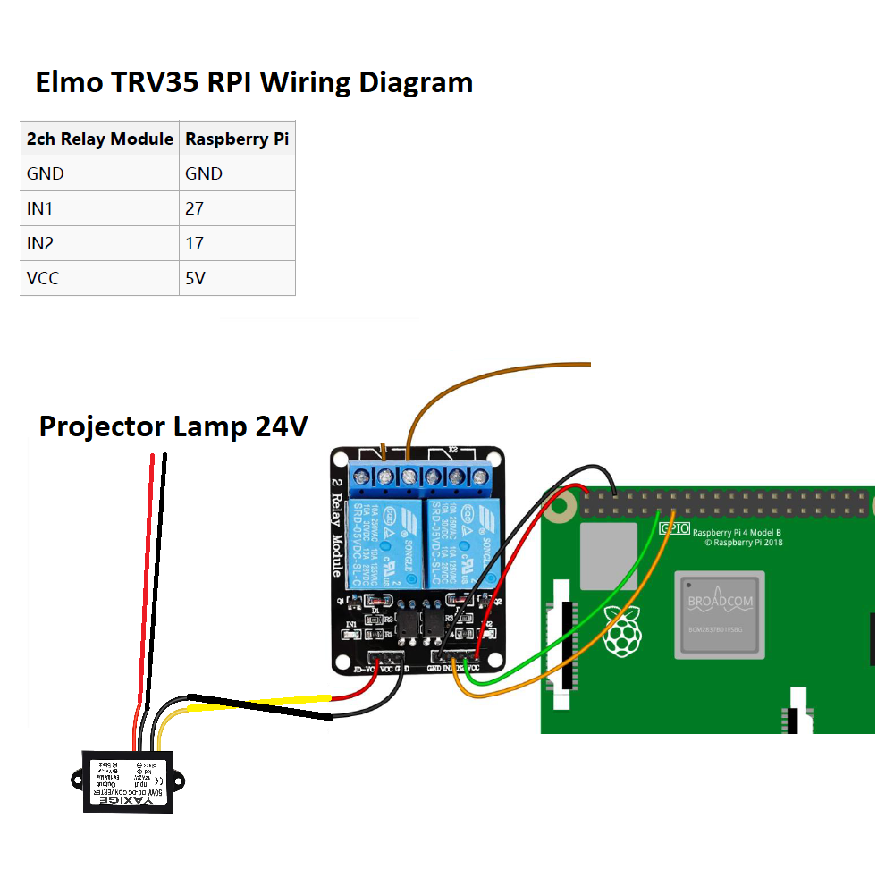

# Slide Recorder with GPIO Relay Control

This project captures film slides full-screen with a Raspberry Pi HQ Camera and adds keyboard control for a 2-channel relay module so the projector can be stepped forward or backward from the keyboard.

The current software file is:

- `slide_recorder_gpio.py`

## Main features

- Full-screen live preview
- Save images as sequential JPEGs: `slide1.jpg`, `slide2.jpg`, ...
- Manual/auto exposure toggle
- Manual color adjustment mode
- Relay pulse output for projector control
- On-screen status messages

## Keyboard controls

| Key | Function |
|---|---|
| `Space` | Save current slide image |
| `f` | Pulse **GPIO17** LOW for 300 ms (forward) |
| `b` | Pulse **GPIO27** LOW for 300 ms (backward) |
| `m` | Toggle auto/manual exposure |
| `c` | Toggle color mode on/off |
| `r` | Select **red** color adjustment (in color mode) |
| `g` | Select **green** color adjustment (in color mode) |
| `u` | Increase selected setting |
| `d` | Decrease selected setting |
| `q` or `Esc` | Quit |

## GPIO behavior

The GPIO outputs are implemented as **open-collector / open-drain style pulses**:

- **Idle:** GPIO is set as **input** (high impedance)
- **Active pulse:** GPIO is switched to **output LOW**
- **Pulse width:** 300 ms
- The GPIO is **never driven HIGH**

This is useful when the relay input side is pulled up externally and you want the Pi to only sink current.

## Wiring notes

Your earlier relay-board setup discussion indicated a split-supply relay module configuration:

- **Relay coil supply:** 5V
- **Logic/input supply:** 3.3V
- **Common ground:** required
- **Jumper between logic and relay supply:** removed

This avoids exposing Raspberry Pi GPIO pins to 5V.

## Wiring diagram

Below is the wiring diagram you provided:



### Important mapping note

The provided wiring diagram labels the relay inputs as:

- **IN1 → GPIO27**
- **IN2 → GPIO17**

However, the current software behavior is:

- **`f` key → GPIO17**
- **`b` key → GPIO27**

So the software mapping follows the **GPIO numbers**, not the relay channel labels. If your wiring matches the diagram, then:

- pressing **`f`** will trigger the relay input connected to **GPIO17**
- pressing **`b`** will trigger the relay input connected to **GPIO27**

If you want `f` and `b` to correspond to specific relay channels instead, either:

1. swap the relay input wires, or
2. change the GPIO assignment constants in the Python file.

## Default GPIO assignments in the script

Inside `slide_recorder_gpio.py`:

```python
FORWARD_GPIO = 17  # BCM numbering; physical pin 11
REVERSE_GPIO = 27  # BCM numbering; physical pin 13
```

## Raspberry Pi header pins used

| Function | BCM GPIO | Physical pin |
|---|---:|---:|
| Forward pulse | GPIO17 | 11 |
| Backward pulse | GPIO27 | 13 |
| 3.3V logic supply | — | 1 |
| 5V relay supply | — | 2 |
| Ground | — | 6 |

## Required packages

Install the required Python packages on Raspberry Pi OS:

```bash
sudo apt update
sudo apt install -y python3-opencv python3-rpi.gpio python3-picamera2
```

Depending on your setup, `python3-libcamera` may also already be present as part of the camera stack.

## Run the program

From the folder containing the script:

```bash
python3 slide_recorder_gpio.py
```

Saved images will be written to the current working directory.

## File naming

Captured slide images are saved as:

- `slide1.jpg`
- `slide2.jpg`
- `slide3.jpg`
- ...

The script automatically finds the next available number.

## Exposure control

Press `m` to toggle manual exposure.

When manual exposure is enabled:

- `u` increases exposure
- `d` decreases exposure

## Color control

Press `c` to enter color mode.

In color mode:

- `r` selects red adjustment
- `g` selects green adjustment
- `u` / `d` adjust the selected color

Press `c` again to return to automatic white balance / normal mode.

## Exit behavior

When the program exits:

- relay pulse outputs are released back to high impedance
- camera is stopped and closed
- OpenCV windows are destroyed

## Troubleshooting

### Relay does not trigger

- Confirm relay-board jumper is removed if using split supplies
- Confirm relay logic side is powered from **3.3V**, not 5V
- Confirm coil side is powered from **5V**
- Confirm grounds are common
- Confirm the relay input is compatible with open-collector style drive
- Verify wiring of GPIO17 and GPIO27

### Wrong relay moves the projector

This usually means the two relay input wires are swapped relative to the intended software function.

### Preview opens but keys seem wrong

Make sure the preview window has keyboard focus.

### Camera errors

Check that:

- Raspberry Pi camera interface is enabled
- the HQ camera is connected correctly
- `imx477.json` is available for the tuning file

## Files

- `slide_recorder_gpio.py` — camera capture and relay-control program
- `README.md` — this file
- `elmo_trv35_rpi_wiring_diagram.png` — user-provided wiring diagram

